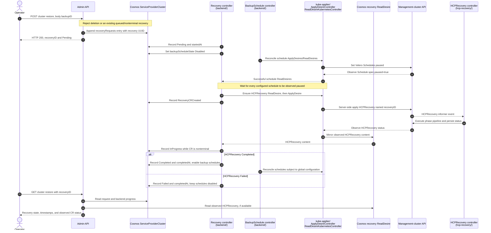
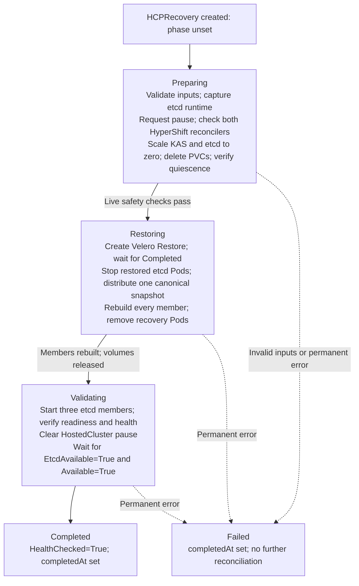
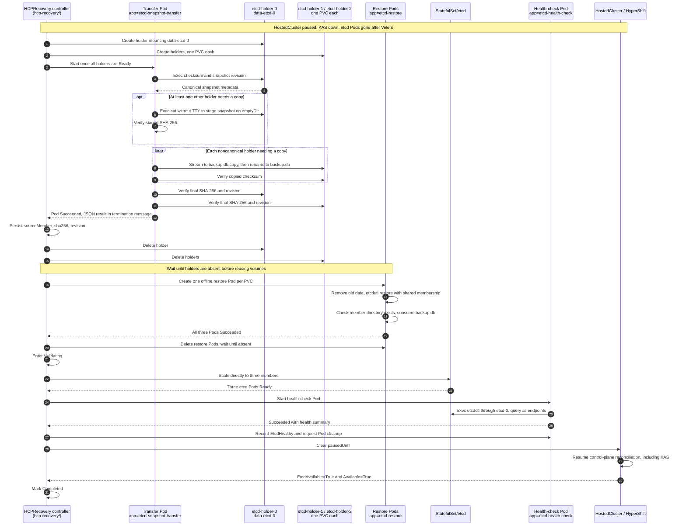
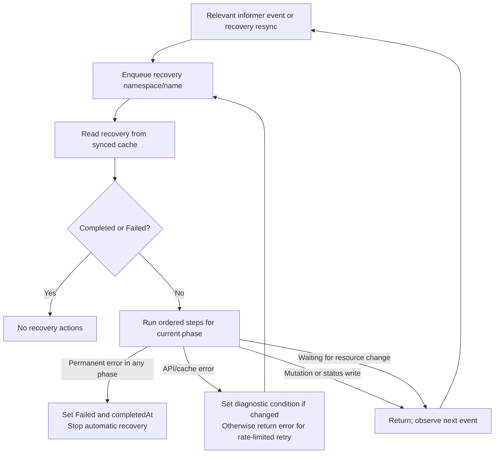

# Hosted cluster recovery: implemented controller flow

This guide describes the implementation in the current source tree, including the
in-place etcd restore pipeline. It is an engineering walkthrough, not evidence of a
successful live recovery or a replacement for the [manual restore SOP](../../docs/etcd-restore.md).

Recovery rebuilds **three etcd members from a selected Velero backup**, then hands
control back to HyperShift. It does not recreate the HostedCluster, its namespaces,
worker nodes, or Azure infrastructure. The existing HostedCluster and etcd StatefulSet
must be present. The operator selects the backup; the controllers do not choose a
backup based on incident time or determine whether its contents are application-correct.

## 1. Two controllers, two progress models

| Component | Responsibility | Persistent progress |
|---|---|---|
| Admin API, service cluster | Accept a backup ID, reject concurrent recovery/deletion, assign a recovery UUID. | Append to Cosmos `ServiceProviderCluster.spec.recoveryRequests`. |
| Backend `Recovery` controller | Pause backup schedules, submit the management-cluster operation through kube-applier, mirror its terminal outcome. | `ServiceProviderCluster.status.recoveries` and `spec.backupScheduleState`. |
| Backend `BackupSchedule` controller and kube-applier | Apply desired Schedule/HCPRecovery resources and report observed resources through ReadDesires. | Cosmos ApplyDesires/ReadDesires; Kubernetes resources on the management cluster. |
| Management-cluster `HCPRecovery` controller | Quiesce the control plane, restore volumes, rebuild etcd, verify, and resume HyperShift. | `HCPRecovery.status.phase`, conditions, snapshot details, and timestamps. |
| Velero and short-lived recovery Pods | Perform volume restoration and the filesystem/etcd operations. | Velero Restore status and Pod status/termination messages. |

`ServiceProviderCluster` is a **Cosmos document**, not a Kubernetes CR.
ApplyDesires describe resources kube-applier should apply; ReadDesires carry observed
Kubernetes content back to the backend. The backend does not run the offline restore
steps itself.

### Request and cross-cluster handoff

Controller labels use the value of the Go controller-name constant and show the
owning directory. For example, `RecoveryControllerName` is
[`Recovery` in `backend/`](../../backend/pkg/controllers/cluster/recovery/recovery_controller.go)
but [`HCPRecovery` in `hcp-recovery/`](../pkg/controller/recovery_controller.go).



The routes are `POST` and `GET` on the admin HCP resource's `/restore` suffix;
GET reports one recovery with `?recoveryID=<id>` or lists all recoveries newest first without it;
POST accepts `{"backupID":"<velero-backup-name>"}`.
HTTP 200 means **queued**, not restored. Likewise, `RecoveryCRCreated` means the
desires were ensured, not that Kubernetes creation has already been observed.
`recoveryState` is the backend's coarse state. GET also returns the last observed CR
`status` once available; its absence means there is no observation to report, not that recovery failed.
Completion enables the per-cluster backup setting, but does not wait for schedules
to become active. A deployment-wide pause still applies unless lifted by the
cluster's backup schedule override.

The backend creates the CR in `hcp-recovery`, using the management cluster and
namespaces recorded on the ServiceProviderCluster. It takes the HostedCluster name
from the cluster's DNS base-domain prefix. Its prerequisites also exclude a deleting
cluster and require this placement information.

Sources: [admin handlers](../../admin/server/handlers/hcp/restore.go),
[route registration](../../admin/server/server/admin.go),
[`BackupSchedule`](../../backend/pkg/controllers/cluster/backups/schedule_controller.go),
[`ApplyDesireController`](../../kube-applier/pkg/controllers/apply_desire/controller.go),
and [`ReadDesireKubernetesController`](../../kube-applier/pkg/controllers/read_desire_kubernetes/controller.go).

## 2. Management-cluster phase pipeline

The phase names below are the literal `status.phase` values. Each box summarizes
many reconciliations, not one long-running controller call. The CR spec is immutable;
the controller and CRD enforce forward-only transitions.



### Phase gates and the reasons for them

| Phase | Ordered work and exit gate |
|---|---|
| `Preparing` | Validate the backup and target, capture the etcd image and Pod identity, then request the HostedCluster pause. Check both HyperShift reconcilers before scaling `deployment/kube-apiserver` and then `statefulset/etcd` to zero. Wait for zero reported replicas, delete PVCs labeled `app=etcd`, and verify quiescence against the live API. See the [preparation gates](#preparation-gates) below. |
| `Restoring` | Persist `<recovery-name>-restore` as `status.restoreName` before creating the Restore in `velero`. Request `restorePVs=true`, `existingResourcePolicy=update`, resource kinds `pvc`, `pv`, `statefulsets`, and a 15-minute item-operation timeout. Wait for Velero `Completed`; `Failed`, `FailedValidation`, or `PartiallyFailed` fail the recovery. Velero brings the StatefulSet back at its backed-up size, allowing WaitForFirstConsumer volume binding/restoration. Scale etcd to zero **again** and confirm `app=etcd` Pods are absent from cache and live API. Create `etcd-holder-0/1/2`, each mounting its own `data-etcd-N` claim, and wait for Ready. Run the snapshot transfer Pod; require success and persist `status.etcdSnapshot` and `EtcdSnapshotDistributed=True`. Delete holders and confirm absence, then create `etcd-restore-0/1/2` to rebuild every member. Require all three Pods to succeed, record `EtcdSnapshotRestored=True`, and delete them. Advance only after the restore Pods are absent. KAS remains down and the HostedCluster paused throughout. |
| `Validating` | Set etcd replicas directly to **three**, not 1, then 2, then 3. Require three Ready etcd Pods (`EtcdScaledUp=True`), then run the health-check Pod. Record `EtcdHealthy=True` only on success and request health-check Pod cleanup. Only then clear the HostedCluster pause with a merge patch setting `pausedUntil=null` and record `HostedClusterUnpaused=True`. Wait for HostedCluster conditions `EtcdAvailable=True` and `Available=True`, then set `HealthChecked=True`, phase `Completed`, and `completedAt`. HyperShift, not this controller, brings KAS and its dependents back. |

These are three active phases, plus terminal `Completed` and `Failed`. The volume,
snapshot, and health operations remain ordered steps within their phase; their
conditions expose progress without additional phase values. The **second** etcd
scale-down belongs to `Restoring`, while startup belongs to `Validating`, so later
reconciliations do not undo startup by replaying the post-Velero scale-down.

### Preparation gates

1. On the first reconcile, record `Preparing` and `startedAt`. Then validate the
   named Backup in `velero`: it must be `Completed`, not deleting, and carry the
   same Azure resource ID as the spec, HostedCluster, and control-plane Namespace
   (case-insensitive). The backup must include exactly the HostedCluster and
   control-plane namespaces; `excludedNamespaces` must not contain either name or `*`.
   For a customer-managed key (CMK), validate the observed active key as described below.
2. Capture the etcd container image and optional `runAsUser` and `fsGroup` from
   the StatefulSet. Patch **only the HostedCluster** to `spec.pausedUntil="true"`.
   Look up the same-named HostedControlPlane in `spec.controlPlaneNamespace`.
   If either object reports `ReconciliationActive=True`, record
   `HostedClusterPaused=False` with reason `HostedClusterPausePending` and wait
   before scaling workloads or deleting claims. A missing HostedControlPlane
   triggers a retry; a missing, `Unknown`, or `False` **condition** on an existing
   object does not block this check. Two explicit `False` acknowledgements are
   not required.
3. Before entering `Restoring`, require no KAS/etcd Pods or etcd PVCs in either
   cache or live lists. Also re-read the HostedCluster pause field, the
   HostedControlPlane's `ReconciliationActive` condition, and both workloads'
   desired and reported replica counts from the API. A live active HostedControlPlane
   blocks `ScaledDownValidated` with reason `HostedControlPlanePausePending`, even
   if the cache showed it paused. Preparation checks run again on each pass;
   earlier `True` recovery conditions do not override drift.

During both the initial quiescence check and the post-Velero etcd Pod check,
the controller can delete a leftover `Failed` or `Succeeded` workload Pod (one per
pass, with a UID precondition). It waits for nonterminal or already-deleting Pods
to drain; a zero workload replica count alone does not release the volumes.

For CMK recoveries, the Backup annotation
`azure.microsoft.com/hcp-cluster-kms-key-fingerprint` must exactly match the
fingerprint derived from `HostedCluster.status.secretEncryption.activeKey.azure`.
A desired key or a matching rotation-history fingerprint cannot authorize an
old-key restore: the customer controls the Key Vault key, and this flow does not
restore keys or encryption configuration. A rotation target or an in-progress
latest history entry rejects recovery before pause, scale-down, or PVC deletion.
With a cleared target, empty history and terminal `Completed`/`Interrupted` entries
are allowed, but the active-key match is still required. Missing observed key
identity or unknown rotation state also rejects recovery. These failures set
`RecoveryInputsValidated=False` and phase `Failed`; after resolving the issue,
select a compatible backup and create a new HCPRecovery. Non-CMK behavior is
unchanged, but a CMK-stamped backup is incompatible with a non-CMK target.
Fingerprint validation does not probe Key Vault access or availability.

The restore resource-kind filter is **not an object-name or namespace filter**.
The created Restore has no `includedNamespaces` or label selector; its effective
scope is those resource kinds within the selected backup. Do not assume the
controller narrows an arbitrary backup to just three etcd PVCs.

Sources: [phase dispatch and ordering](../pkg/controller/recovery_controller.go).
Each active phase has its own file, with steps in execution order:

- [Preparing](../pkg/controller/preparing.go): validate inputs, capture runtime details,
  pause the HostedCluster, scale down KAS and etcd, delete PVCs, and verify quiescence.
- [Restoring](../pkg/controller/restoring.go): run the Velero restore, scale etcd down
  again, wait for its volumes to be released, distribute the snapshot, and restore each member.
- [Validating](../pkg/controller/validating.go): start etcd, check its health, unpause the
  HostedCluster, and verify it is healthy.

## 3. How one snapshot becomes one etcd cluster

The backup hook produces `/var/lib/backup.db` independently on each etcd volume.
Those snapshots can differ. Restoring each member from its own snapshot is not the
recovery algorithm: every member must use the **same snapshot and membership**.
The PVCs are zonal, ReadWriteOnce volumes, so one Pod cannot mount all three.



### Worker contracts

These are standalone **Pods with `restartPolicy: Never`**, not Jobs.
The controller creates/deletes Kubernetes objects; it does not stream snapshots or
poll etcd itself. Long-running work happens inside the transfer/health Pods.

| Pod | Location, tools, and result |
|---|---|
| `etcd-holder-N` | Control-plane namespace, one PVC, captured etcd image and pod identity. Sleeps to make the volume available for exec. |
| `<recovery-name>-snapshot-transfer` | Recovery namespace; configured worker image with `kubectl`, `jq`, and `sha256sum`; stages on `emptyDir`, not an etcd PVC. Uses **etcd-0**, not the highest-revision member, as canonical. Retries transfer operations with a 30-minute retry deadline. Success requires matching SHA-256 **and revision on all three volumes**. Writes `{sourceMember, sha256, revision}` to `/dev/termination-log`. |
| `etcd-restore-N` | Control-plane namespace, one PVC, captured etcd image and identity. Uses `etcdutl snapshot restore` with the same three-member `--initial-cluster`, token `etcd-cluster`, `--bump-revision 1000000000`, and `--mark-compacted`. Only `--name` and the member's advertised peer URL differ. |
| `<recovery-name>-etcd-health-check` | Recovery namespace, configured worker image. Execs `etcdctl` in `etcd-0` using that member's existing TLS files and addresses all three endpoints. Retries health checks with a 10-minute retry deadline. Success writes a summary to the termination log. |

The revision bump avoids reusing old revisions; marking the bumped history compacted
forces stale Kubernetes watches to relist. The fixed bump is not proof that the
restored revision exceeds every revision observed before the outage.

Offline restore must not treat a pre-existing `/var/lib/data/member` directory
alone as success: Velero restores that old directory too. The script first checks
for `backup.db`; when present, it discards old data and performs the restore. Only
after a successful restore and a member-directory check does it delete `backup.db`.
A replacement Pod skips work only when the snapshot is absent **and** the member
directory exists; absent snapshot plus absent member directory fails.

Holder/restore Pods have no mounted API token. Transfer/health Pods use a separate
worker ServiceAccount with exec access to the named holder Pods and `etcd-0`.
Only the latter Pods have HCPRecovery owner references, because they share its
namespace. Cross-namespace holder/restore cleanup is explicit.

Sources: [Pod definitions, constants, and cleanup](../pkg/controller/etcd_recovery_pods.go),
[transfer script](../pkg/controller/etcd/distribute-snapshot.sh),
[restore script](../pkg/controller/etcd/restore-member.sh), and
[worker RBAC](../deploy/templates/worker-rbac.yaml).

### What the health gate actually proves

The [health script](../pkg/controller/etcd/check-etcd-health.sh) checks:

- Exactly three members, all named, with peer/client URLs, and none marked learner.
- Exactly three endpoint-status results with one cluster ID, one Raft term, and
  exactly one result whose member ID equals its leader ID.
- The **first endpoint-status result's** revision is at least `1000000000`.
- Exactly three endpoint-health results, all healthy.

This is stronger than Pod readiness, but is not a comparison of restored member IDs
before startup, nor a check of equal Raft indexes or equal revisions on all endpoints.
The controller accepts successful offline restore Pods without parsing their etcdutl
logs for cluster/member IDs. The live health gate runs **after** etcd starts and
**before** the HostedCluster is unpaused.

## 4. Reconciliation, persistence, and failures



The controller runs under leader election and waits for all configured informer
caches to sync. Steps return an outcome after an action, status change, or unmet
gate. Successful paths normally perform one mutation per reconcile, allowing the
cache to observe it before the next step. Status uses server-side apply with field
manager `hcp-recovery`, UID/resource-version preconditions, conditions merged by
type, and unchanged condition content preserving its timestamp.

The controller waits for nine informer caches. An event does not necessarily
enqueue a recovery: the handlers use the following scopes and filters.

| Resource | Watch scope | What enqueues a recovery |
|---|---|---|
| HCPRecovery | Controller namespace | Add, update (including status), or delete, keyed by namespace/name. |
| HostedCluster / HostedControlPlane | All namespaces | HostedCluster updates; HostedControlPlane adds, updates, and deletes. Both use the recovery index on HostedCluster and control-plane namespaces. |
| Deployment / StatefulSet | All namespaces | Deployment adds or desired-replica changes; `etcd` StatefulSet updates when desired, reported, or ready replicas change. |
| Pod / PVC | All namespaces | Updates and deletes. KAS, etcd, holder, and restore Pods map by namespace; transfer and health Pods map by recovery-name label. PVC events map by namespace. |
| Velero Restore / Backup | `velero` | Restore adds, updates, and deletes map by the `hcprecovery.aro-hcp.azure.com/control-plane-namespace` label. Backup is a validation cache with **no** enqueue handler. |

Factories resync every ten minutes. The controller reads the control-plane
Namespace directly; it does not watch Namespaces or Velero Schedules. Observing
schedule pause is the backend's responsibility before it submits the recovery.

Durable checkpoints prevent normal controller restarts from redoing finished work:
`restoreName` is stored before Velero creation, `etcdSnapshot` before holder cleanup,
`EtcdSnapshotRestored=True` before restore-Pod cleanup, and `EtcdHealthy=True` before
health-Pod cleanup. Resources have deterministic names and are reused when present.
Cleanup gates for volume-bearing Pods confirm absence against the live API when the
cache is empty. Failed or evicted holders can be recreated while distribution is
unfinished; a failed transfer, offline restore, or health-check Pod is terminal.

**Failure does not mean rollback.** Invalid preparation inputs set `Failed` and
`completedAt`; the immutable spec cannot be corrected on the same recovery request.
Retryable API/cache errors remain retryable in every active phase. A permanent error
in `Preparing`, `Restoring`, or `Validating` sets `Failed` and `completedAt`; both `Failed` and
`Completed` are terminal. There is no automatic unpause on failure or failed-operation
cleanup, and etcd may already be running if the health gate failed. The backend keeps backup
schedules disabled on failure. Diagnose the last condition and resource state before
planning another attempt; do not reset phase or delete the CR as a substitute for
cleanup. In particular, check `etcd-holder-N` and `etcd-restore-N` in the
control-plane namespace before a new attempt. The controller looks up those Pods
by fixed names but cleans them up by recovery label. A leftover Pod from a failed
attempt can therefore be mistaken for the new recovery's worker.

There is no overall recovery timeout. The worker retry deadlines apply once their
scripts are running, not to Pod scheduling, volume attachment, or the final
HostedCluster health wait; those waits can leave the recovery nonterminal.

Sources: [controller loop, transition validation, error policy](../pkg/controller/recovery_controller.go),
[informer routing](../pkg/controller/recovery_controller_informers.go),
[runtime wiring](../cmd/options.go), [status helper](../pkg/controller/status.go),
and [API types and phase validation](../pkg/apis/hcprecovery/v1alpha1/types.go).

## 5. Reading progress during development or diagnosis

Start with `GET /restore?recoveryID=<id>` on the admin HCP resource. Look at
`recoveryState` for the backend handoff, then `status.phase` and each condition's
`reason` and `message` for the management-cluster step. The status in this response
is a mirrored observation, not a live Kubernetes read.

With the management-cluster context selected and `RECOVERY_ID` set to the returned
UUID, inspect the live objects without changing the recovery:

```bash
kubectl -n hcp-recovery get hcprecovery "$RECOVERY_ID" -o yaml
HCP_NS=$(kubectl -n hcp-recovery get hcprecovery "$RECOVERY_ID" -o jsonpath='{.spec.controlPlaneNamespace}')
HC=$(kubectl -n hcp-recovery get hcprecovery "$RECOVERY_ID" -o jsonpath='{.spec.hostedClusterName}')
HC_NS=$(kubectl -n hcp-recovery get hcprecovery "$RECOVERY_ID" -o jsonpath='{.spec.hostedClusterNamespace}')
kubectl -n "$HC_NS" get hostedcluster "$HC" -o yaml
kubectl -n "$HCP_NS" get hostedcontrolplane "$HC" -o yaml
kubectl -n "$HCP_NS" get pods,pvc
kubectl -n hcp-recovery get pods \
  -l "hcprecovery.aro-hcp.azure.com/recovery-name=$RECOVERY_ID"

# The name is assigned during Restoring, before the Restore is created.
RESTORE=$(kubectl -n hcp-recovery get hcprecovery "$RECOVERY_ID" -o jsonpath='{.status.restoreName}')
if [ -n "$RESTORE" ]; then kubectl -n velero get restores.velero.io "$RESTORE" -o yaml; fi
```

`startedAt`/`completedAt` on the CR describe management-cluster execution; the
backend's start time can precede CR creation. `status.etcdSnapshot` records the
source member, checksum, and **pre-bump** revision, not a wall-clock recovery point.
Although `restoredToTimestamp` exists in the API, this pipeline does not populate it.

Unlike the manual SOP, the controller uses `etcd-0` rather than the freshest
snapshot, streams it without a TTY and verifies the checksum rather than using
tar, and rebuilds members in standalone Pods rather than Jobs. It checks live
cluster health after startup; it does not compare cluster/member IDs before startup.
